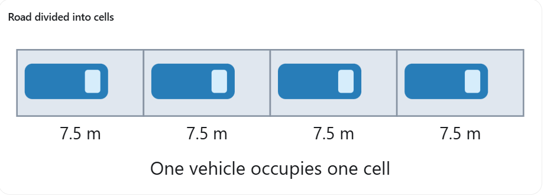
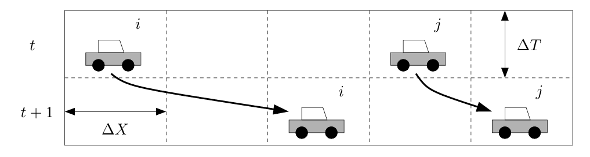
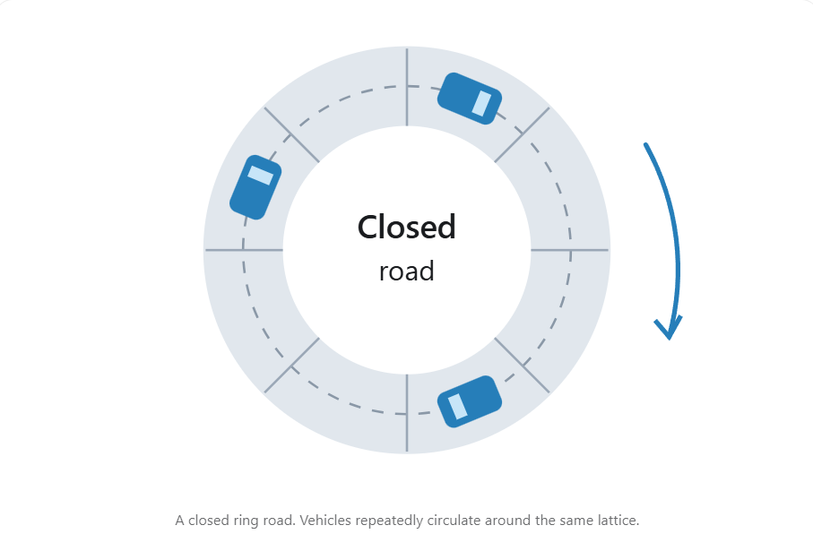
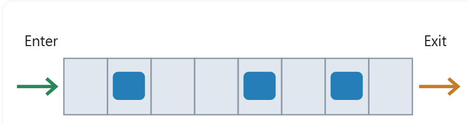
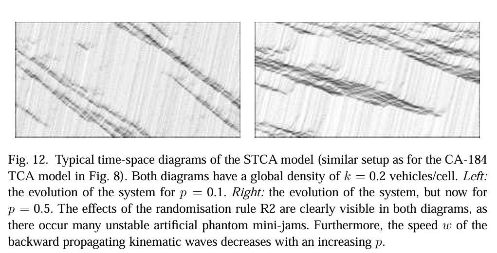
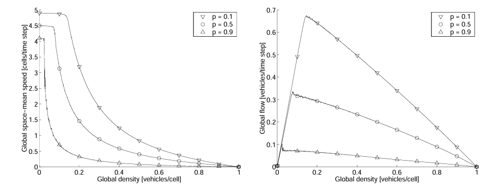

# Cellular Automata Models of Road Traffic

1. The physical environment
   1. Structure: a discrete lattice of cells with a rectangular, hexagonal, or other topology
   2. Typically, cells are all equal in size. Lattice itself can be finite or infinite in size
   3. Dimension: can range from 1, which is called elementary cellular automaton(ECA), to 3 in most cases

2. The cells' states
   1. not restricted to an integer, a continuous range of values is also possible (coupled map lattices)
   2. States of all cells collectively: a CA's global configuration
3. The cell's neighborhood
   1. The size of neighborhood is the same for each cell in the lattice
   2. Can include itself
   3. As the dimensionality of the lattice increases, the number of direct neighbors of a cell increases exponentially

4. A local transition rule
   1. Every cell updates simultaneously based on the previous time step's state
   2. Typically, the same rule is used for all the cells
   3. deterministic CA: no stochastic components in the rule stochastic CA: includes probabilistic components
   4. A CA is reversible if we can uniquely determine its previous state from its current state
   5. A Garden of Eden state is a configuration that cannot be produced from any previous configuration

5. single cell model: each cell can either be empty, or is occupied by exactly one vehicle; multi-cell model: allows a vehicle to span several consecutive cells

6. Spatial discretization: the length of each cell is chosen based on how much road space one vehicle typically occupies in a traffic jam

   For example, assume:

   - Average car length: 5 meters.

   - Average gap between stopped cars: 2.5 meters.

   - Therefore, each cell represents 7.5 meters.

     

7. Temporal discretization: the duration of each simulation time step is chosen to approximate how long a driver takes to react to traffic conditions (discrete time)

   

8. Two types of boundary conditions:
   1. Closed system:
   2. Open system:

9. TCA's local transition rule:
   1. Car-following rules: determine how a vehicle moves based on the vehicle in front of it.
   2. Lane-changing rules: determine whether a vehicle can move into another lane
   3. Consecutively: Different rules are applied in a specified order.
   4. position update:
      1. In parallel: The vehicles are updated simultaneously within the simulation time step
      2. random sequential: updating processes vehicles individually in a randomly chosen order
   5. implicit reaction time: driver's reaction time can not occur between two time steps, need to push to the next time step

10. Anisotropic particles: vehicles only react to what is ahead

11. anticipation: Advanced models also consider the leader's observed behavior. The model uses observed information about the leader, rather than accurately predicting what the leader will do in the future.

12. Nagel-Schreckenberg model (NaSch / STCA, 1992): uses random slowdowns to show how traffic jams can start without a road blockage.

    1. Symbols: $g_i$ = empty cells ahead; $v_i$ = car speed (cells/time step); $p$ = chance of a random slowdown.

    2. Rules: follow this order; update all cars together.

       1. Speed up by one, but stay below the speed limit and the empty gap: $u_i=\min\{v_i(t-1)+1,g_i(t-1),v_{\max}\}$. A car may brake sharply.
       2. With chance $p$, slow down by one: $v_i(t)=\max\{0,u_i-1\}$. Otherwise, $v_i(t)=u_i$. Make a new random choice for each car each step.
       3. Move: $x_i(t)=x_i(t-1)+v_i(t)$.

    3. Random slowdowns roughly represent changes in driving and braking too much.

       1. Small jams can appear even in light traffic.
       2. Large gaps let small jams fade; above a critical density, jams can last.

    4. Results (Figs. 12-13):

       1. With enough space, speed is $v_{\max}$ or $v_{\max}-1$. Average: $v_{\mathrm{ff}}=v_{\max}-p$.

       2. Higher $p$ means lower average speed, lower maximum flow, and jams at lower density. The crowded-traffic curve becomes lower and flatter.

          

          x-axis: time 

          y-axis: the position of the vehicle

       3. Randomness bends both flow-density branches. Small apparent capacity drops come from using a finite road.

          

          Global flow: how many cars pass a road position per time step, averaged over the whole simulated road