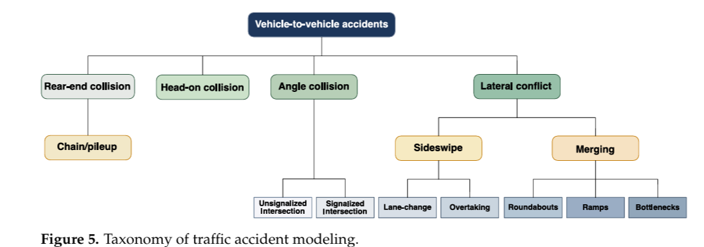
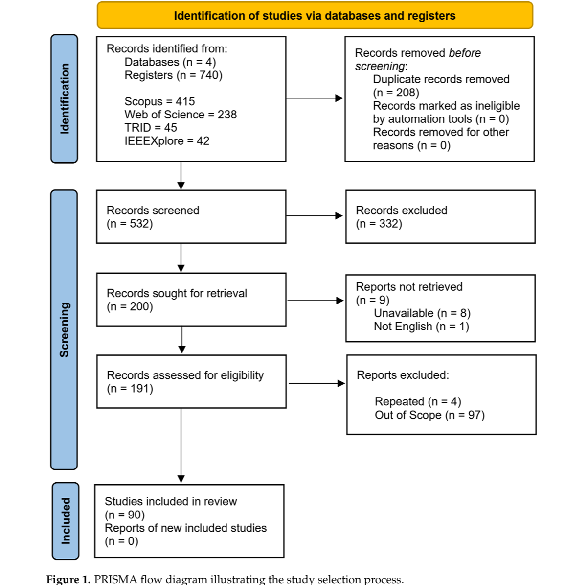

# Marzoug, R., Lakouari, N., Pérez-Cruz, J. R., & Hurtado-Beltran, A. (2026). Cellular automata for traffic accident analysis: A systematic review. Mathematics, 14(17), 3091.

1. Main idea: How can cellular automata (CA) be used to simulate vehicle-to-vehicle traffic accidents, and what are the limitations of existing models? Traditional CA traffic models, such as the Nagel–Schreckenberg (NaSch) model, are primarily designed to simulate traffic flow and congestion. This creates a limitation: the model can simulate traffic congestion but cannot directly reproduce traffic accidents under its standard rules

2. Proposes a unified taxonomy of CA-based vehicle accident models. 

   Proposed accident classification:

   

3. They searched four databases: Scopus, Web of Science, TRID, and IEEE Xplore

   

4. Results:

   1. The authors found that rear-end collisions are the most extensively investigated accident type in CA literature. Head-on collisions and lateral conflicts have received considerably less attention.

   2. Most models have limited real-world validation. It shows that most existing CA accident models have not been calibrated against real-world data or empirically validated.

   3. Accident modeling has become more sophisticated. 

      | Earlier approaches          | More recent approaches                        |
      | --------------------------- | --------------------------------------------- |
      | Fixed collision conditions  | Continuous safety-risk indicators             |
      | Simplified driver behavior  | Driver reaction times and aggressive behavior |
      | Mostly homogeneous vehicles | Mixed vehicle types                           |
      | Basic roadway scenarios     | Intersections, merging, autonomous vehicles   |

      One important development is the use of time-to-collision (TTC) and post-encroachment time (PET) to detect dangerous situations without requiring an actual simulated collision.

