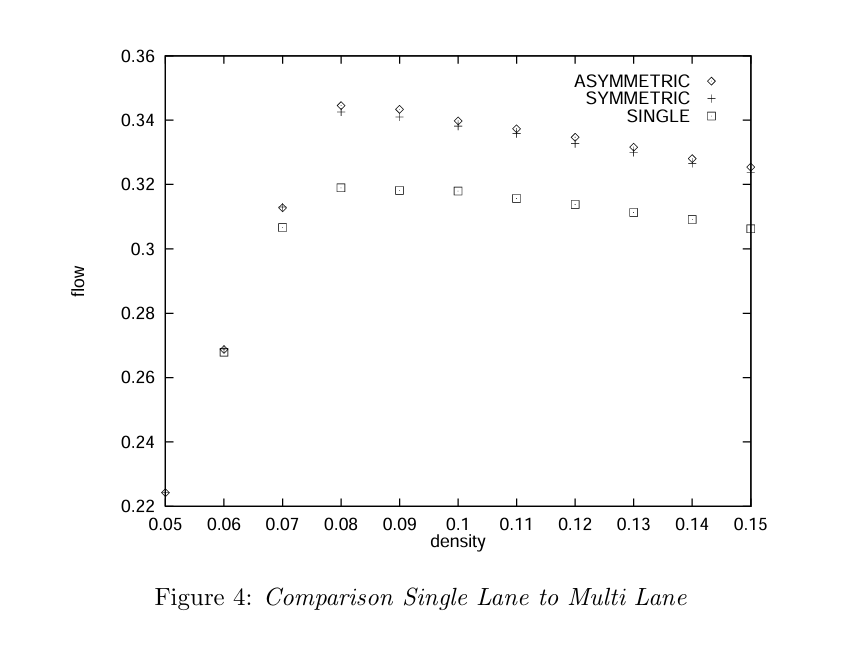
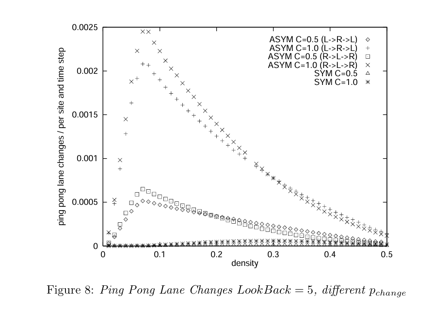
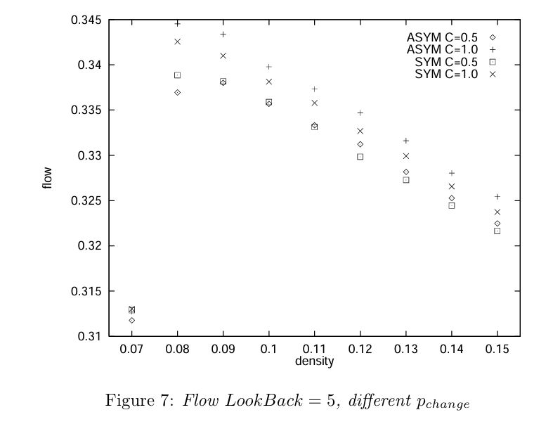

# Rickert, M., Nagel, K., Schreckenberg, M., & Latour, A. (1996). “Two lane traffic simulations using cellular automata.”

1. Main idea: Two parallel NaSch models connected by lane-changing rules

2. Step 1: Lane changing. Evaluate neighboring vehicles and move eligible cars sideways simultaneously.

   Step 2: Apply the NaSch acceleration, braking, randomization, and forward movement rules independently on each lane

3. Four lane-changing rules (T1–T4): A vehicle changes lanes only when all four conditions are satisfied

   * T1 — Motivation: The current lane has insufficient space ahead (\(gap(i)<l\))

   * T2 — Advantage: The other lane has enough forward space (\(gap_o(i)>l_o\))

   * T3 — Safety: There is enough room behind on the target lane (\(gap_{o,back}(i)>l_{o,back}\))

   * T4 — Randomness: The driver accepts the lane change probabilistically (\(rand()<p_{change}\))

     | Characteristic         | Idea introduced                                              |
     | ---------------------- | ------------------------------------------------------------ |
     | Symmetry               | Whether changing left and changing right follow equivalent rules. |
     | Stochasticity          | Random lane-changing decisions prevent excessive synchronization and unrealistic movement. |
     | Direction of causality | Checking vehicles behind in the destination lane accounts for how a lane change affects following traffic. |

     Density per lane is defined as:

     \[ \rho=\frac{N}{2L} \]

     where \(N\) is the total number of vehicles and \(L\) is the road length in cells. The factor 2 represents two lanes.

4. Symmetric vs. asymmetric lane-changing models

   * Symmetric: Both directions use equivalent motivation rules. Drivers change lanes when their current lane becomes obstructed. Fewer lane changes
   * Asymmetric: Drivers prefer the right lane and return when the target space is safe, even without being blocked on the left. More frequent lane changes.

5. Findings:

   * Both symmetric and asymmetric models achieve a maximum combined flow higher than twice the maximum single-lane flow

     

   * Randomness can reduce unrealistic lane-switching behavior without significantly decreasing traffic flow

     * Cooperative ping-pong: Many vehicles simultaneously choose the same apparently empty lane, then all switch back

       

       reducing  \(p_{change}\) from 1.0 to 0.5 reduces repeated back-and-forth lane changes by approximately a factor of five (80%)

     * The flow-density curves for \(p_{change}=0.5\) and \(p_{change}=1.0\) remain relatively close for both symmetric and asymmetric models

       

       
