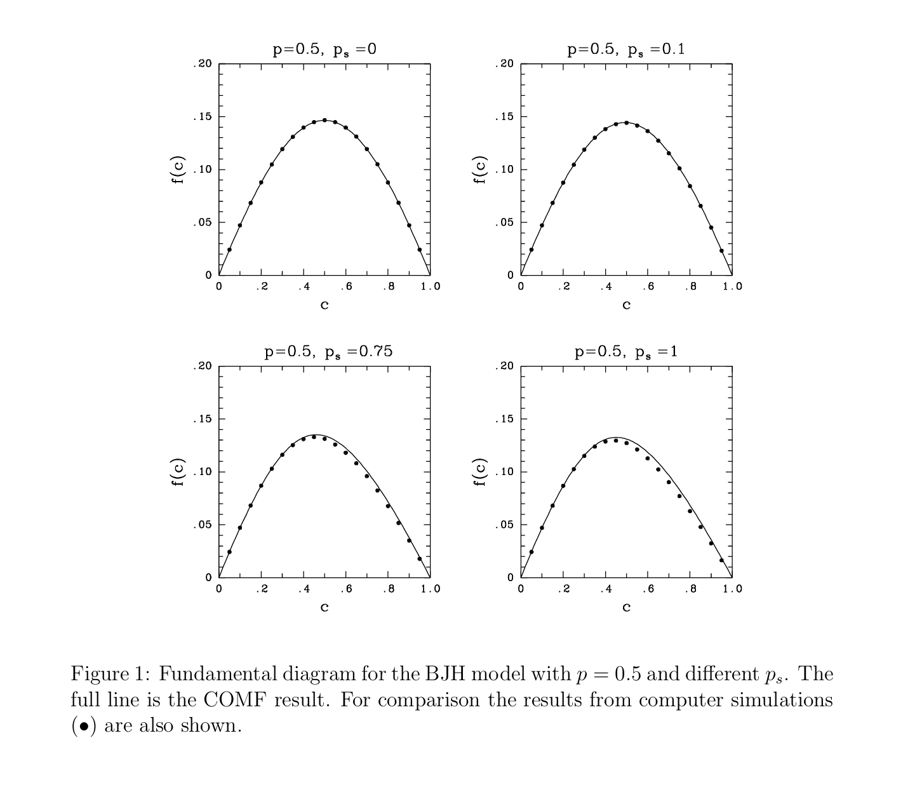
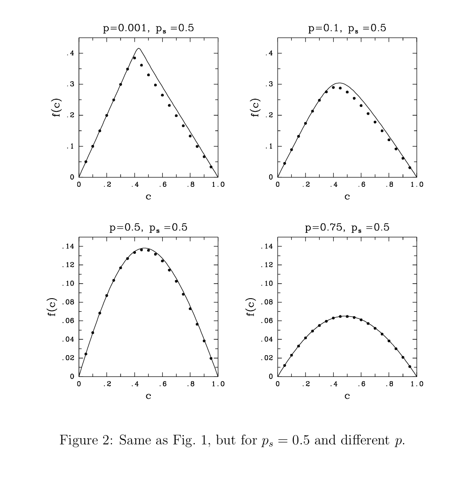
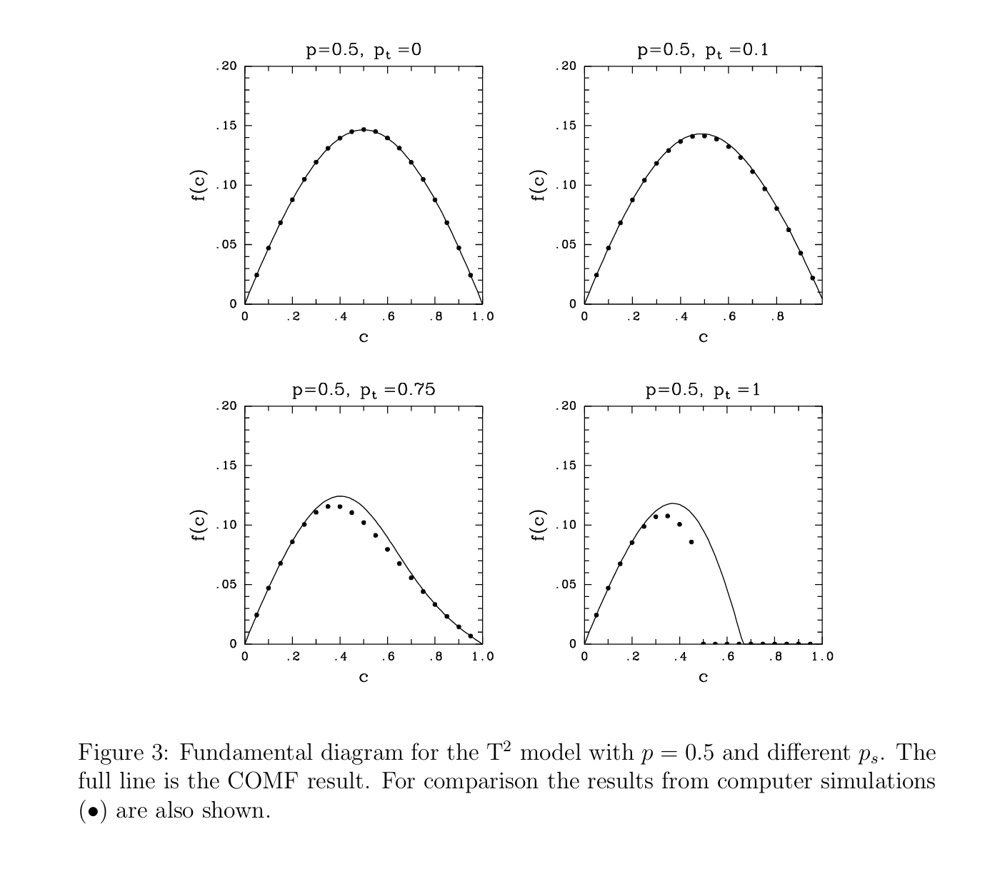
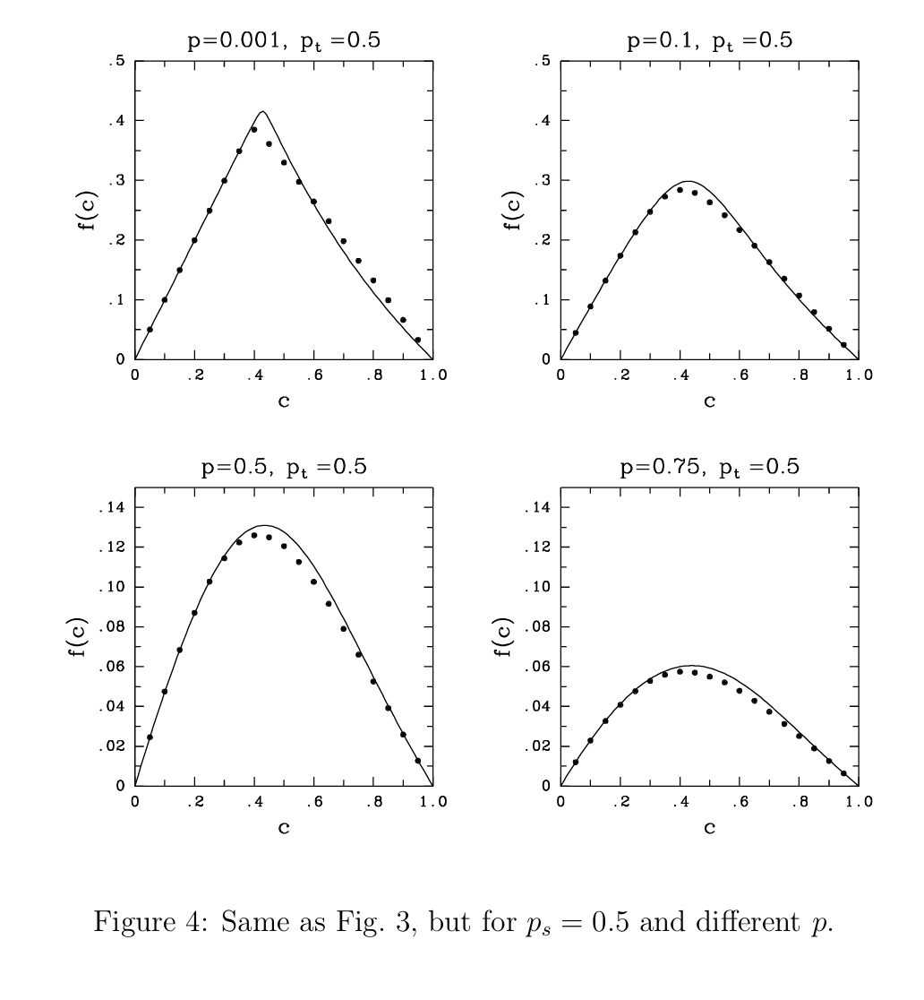

# Schadschneider, A., & Schreckenberg, M. (1997). Traffic flow models with ‘slow-to-start’ rules. Annalen der Physik, 509(7), 541–551.

1. Slow-to-Start Rule
   1. main idea: Even if the road ahead becomes clear, a stopped car may not immediately start moving
   2. Two implementations:
      1. Benjamin–Johnson–Hui (BJH) Model: A vehicle has a reduced probability of restarting after stopped by the ahead vehicle.

         \[ P(\text{restart})=1-p_s \]

         

         

         X-axis: the proportion of road cells occupied by cars

         Y-axis: the average number of cars passing a road cell per simulation time step 2. Takayasu (T²) Model: The vehicles restarts depending on the number of empty cells ahead
         - 0 empty cells: Cannot move
         - 1 empty cell: Restarts with probability \(1-p_t\).
         - 2 or more empty cells: Accelerates to speed 1, before ordinary random braking.

         if \[ p_t=0.6,\quad p=0.5 \]
         - 40% probability of passing the slow-to-start rule.
         - 50% probability of avoiding random braking.

           \[ P(\text{move})=(1-p_t)(1-p) \]

           \[ =0.4\times0.5=0.2 \]

           

           
