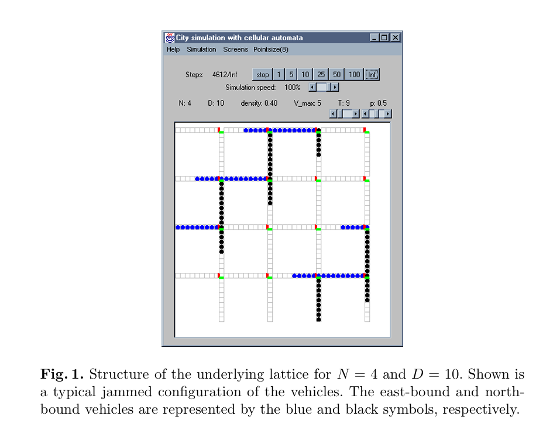
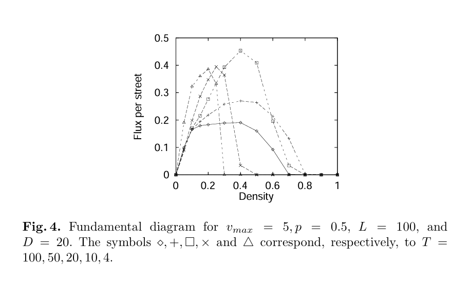

# Schadschneider, A., Chowdhury, D., Brockfeld, E., Klauck, K., Santen, L., & Zittartz, J. (1999). A new cellular automata model for city traffic

1. main idea: proposes a new cellular automata (CA) model for urban traffic by combining two existing traffic models:
   1. Nagel–Schreckenberg (NaSch) model: Simulates highway traffic using acceleration, braking, and random slowdown
   2. Biham–Middleton–Levine (BML) model: Simulates city traffic using a two-dimensional street network with intersections and alternating traffic signals

2. Unified CA traffic model:

   | Feature               | BML                        | NaSch                           | New model                                    |
   | --------------------- | -------------------------- | ------------------------------- | -------------------------------------------- |
   | Road structure        | City grid                  | Single highway                  | City grid                                    |
   | Vehicle speed         | 0 or 1                     | 0 to \(v_{\max}\)               | 0 to \(v_{\max}\)                            |
   | Random braking        | No                         | Yes                             | Yes                                          |
   | Traffic lights        | Simple alternating updates | No                              | Synchronized signals with adjustable periods |
   | Complete traffic jams | Yes                        | No persistent complete gridlock | Yes                                          |

3. The model uses:

   - \(N\) eastbound and \(N\) northbound streets.
   - \(N^2\) intersections.
   - \(D-1\) road cells between adjacent intersections.
   - Street length \(L=ND\).

   Vehicles travel east or north, without turning or changing lanes.

   

4. Synchronized traffic lights

   All intersections follow the same traffic-light cycle:

- Eastbound green and northbound red for \(T\) time steps.
- Northbound green and eastbound red for the next \(T\) time steps.
- Total cycle length: \(2T\).

Unlike BML, the authors can change \(T\) to investigate how signal timing affects traffic.

5. Modified NaSch vehicle rules
   1. Acceleration: Increase speed by 1, up to \(v_{\max}\).
   2. Deceleration: Reduce speed if another vehicle or a red light requires stopping.
   3. Randomization: With probability \(p\), reduce speed by 1.
   4. Movement: Move forward according to the updated speed.

6. One useful finding: Traffic-light timing affects maximum traffic flow

   

   1. Traffic flow is affected by the traffic-light period \(T\).
   2. Shorter green-light periods do not always produce better traffic flow.
   3. Longer green-light periods do not always improve traffic flow either.
   4. An appropriate signal period can improve traffic throughput.
   5. The relationship between traffic-light duration and maximum traffic flow is non-monotonic. In other words, increasing the green-light duration does not consistently increase or decrease traffic flow