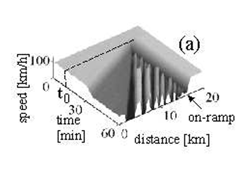

# Cellular automata approach to three-phase traffic theory

1. main idea: an improved cellular automata (CA) traffic model based on three-phase traffic theory to reproduce realistic highway traffic congestion. Traditional CA models, such as the Nagel–Schreckenberg (NaSch) model, can reproduce free-flow traffic and traffic jams. However, they have limitations in describing the more complex behavior of congested traffic. The authors argue that traffic should be classified into three phases rather than simply free flow and congestion

2. 

   | Traffic phase         | Description                                                  |
   | --------------------- | ------------------------------------------------------------ |
   | Free flow (F)         | Vehicles travel relatively fast and have sufficient space between them. |
   | Synchronized flow (S) | Vehicles interact closely and tend to adjust their speeds to those of the vehicles ahead. Traffic is slower, but vehicles continue moving. |
   | Wide moving jam (J)   | Severe congestion occurs, with vehicles moving very slowly or stopping. The jam propagates upstream, against the direction of traffic. |

3. Introducing synchronization distance

   * When the preceding vehicle is far away, the following vehicle can accelerate toward its desired speed.

   * When the preceding vehicle is within synchronization distance, the following vehicle attempts to match its speed.

   * When the actual gap becomes too small, safety rules require the vehicle to slow down.

4. Simulation: The authors used the KKW-1 cellular automata model to simulate traffic on a single-lane highway with an on-ramp, with main-road flow of 2,300 vehicles/hour and on-ramp flow of 500 vehicles/hour.

   | Parameter                          | Value                                            |
   | ---------------------------------- | ------------------------------------------------ |
   | Main-road incoming flow \(q_{in}\) | 2,300 vehicles/hour                              |
   | On-ramp incoming flow \(q_{on}\)   | 500 vehicles/hour                                |
   | Model                              | KKW-1                                            |
   | Observation                        | Speed changes and congestion formation over time |

5. Result:

   

   Using the KKW-1 model, with main-road flow of 2,300 vehicles/hour and on-ramp flow of 500 vehicles/hour, the simulation shows the spontaneous formation of wide moving jams within synchronized flow. This supports three-phase traffic theory by demonstrating the transition from free flow to synchronized flow and subsequently to wide moving jams

