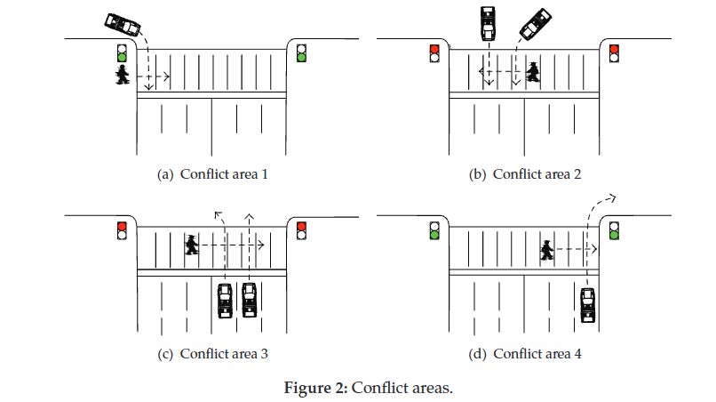
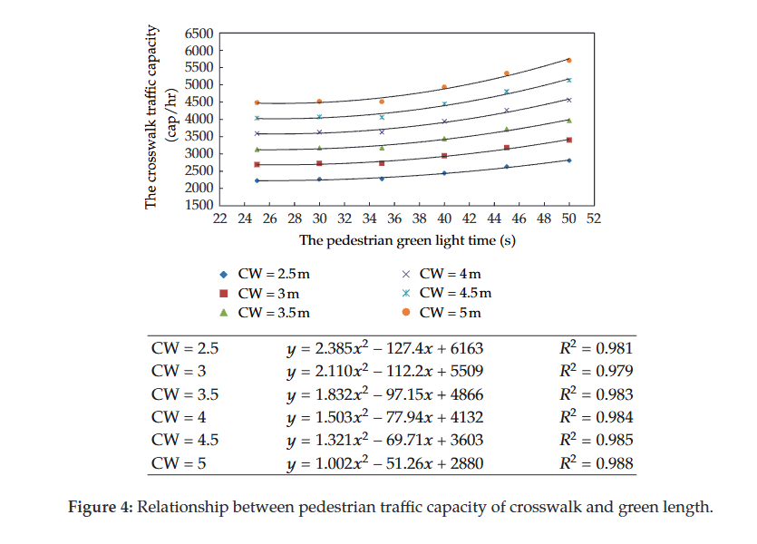
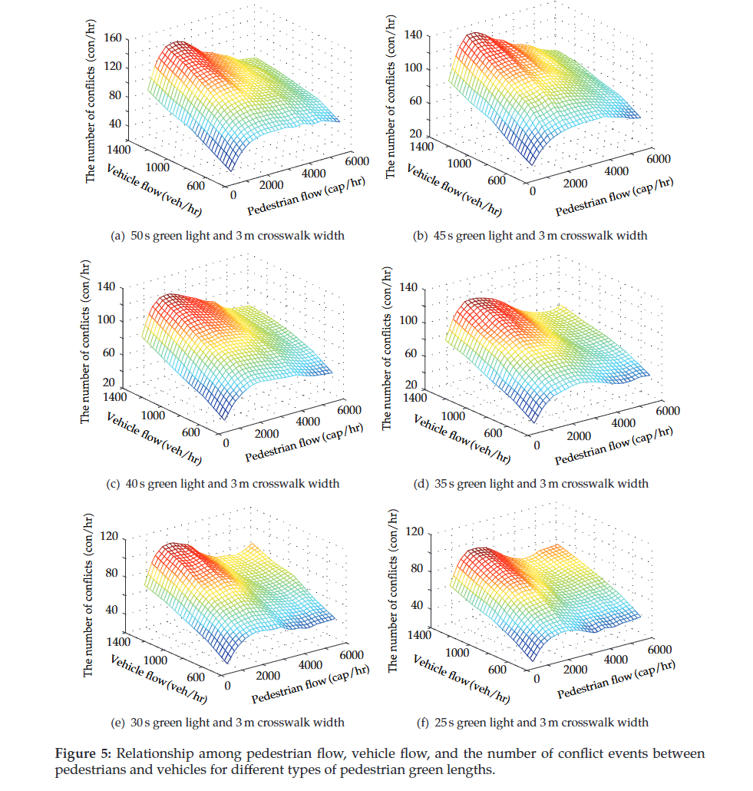
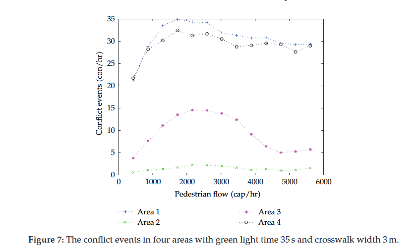

# Using Cellular Automata to Investigate Pedestrian Conflicts with Vehicles in Crosswalk at Signalized Intersection

1. main idea: investigates how pedestrians and vehicles interact and create traffic conflicts at signalized intersections using a Cellular Automata (CA) model

   questions:

   * How do pedestrian green-light duration and crosswalk width affect pedestrian traffic capacity?
   * How do pedestrian and vehicle traffic volumes affect the number of conflicts?
   * How do traffic conflicts and signal timing affect pedestrian delay?

2. Approach: develop a microscopic CA model that represents both pedestrian movement and vehicle interactions within a crosswalk

   1. Pedestrian movement rules:

      1. Forward movement: Pedestrians move according to their assigned walking speed and available empty cells
      2. Lateral movement: Pedestrians can move left or right to avoid obstacles
      3. Collision avoidance: Pedestrians adjust their speeds or positions to avoid other pedestrians
      4. Signal compliance: Pedestrians wait for green before entering, but those still crossing when the light changes can continue moving

   2. Pedestrian–vehicle conflict rules:

      1. The authors divide the crosswalk into four conflict areas based on vehicle direction and where interactions occur.

         | Conflict area | Vehicle movement                                             |
         | ------------- | ------------------------------------------------------------ |
         | Area 1        | Right-turning vehicles from inside the intersection          |
         | Area 2        | Straight or left-turning vehicles from inside the intersection |
         | Area 3        | Straight or left-turning vehicles approaching from the road segment |
         | Area 4        | Right-turning vehicles approaching from the road segment     |

         

         The model uses priority rules to avoid collisions. If a vehicle and pedestrian want to occupy the same currently empty cell, priority is randomly assigned with probability 0.5 for each.

   3. Measuring traffic conflicts:

      * Conflict events: Situations where a vehicle must stop to avoid occupying cells used or about to be used by pedestrians
      * Pedestrian conflict delay: Time pedestrians spend stopped in the crosswalk to avoid passing vehicles

3. Results:

   * Longer green lights and wider crosswalks increase pedestrian capacity

     

   * More pedestrians do not always mean more conflicts

     

   * Right-turning vehicles cause the most conflicts

     
