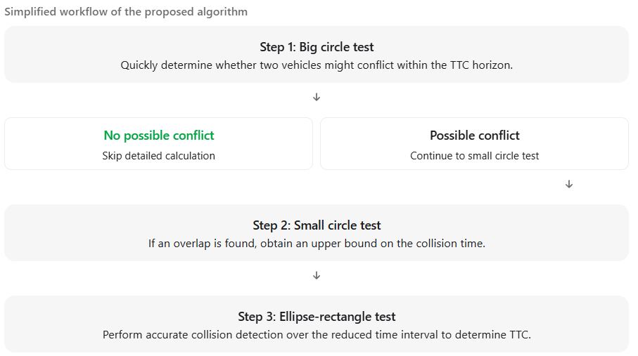
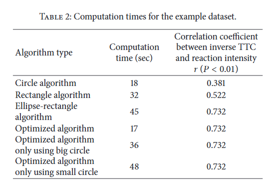

# Paper Summary: New Algorithms for Computing the Time-to-Collision in Freeway Traffic Simulation Models

1. main idea: The paper proposes a more accurate and computationally efficient method for calculating Time-to-Collision (TTC) in freeway traffic simulations, especially when vehicles are changing lanes. TTC measures how much time remains before two vehicles collide if their current motion continues.

   The traditional TTC calculation typically assumes:

   * Vehicles are traveling in the same lane.
   * Only the leading and following vehicles matter.
   * Vehicle movement is one-dimensional.
   * Vehicle acceleration and lateral movement are not fully considered.

2. The authors introduce a two-dimensional TTC calculation that considers vehicle position, velocity, acceleration, physical dimensions, and safety buffer areas

   Three geometric algorithms

   | Algorithm         | Main idea                                                    | Advantage                                    | Disadvantage                                         |
   | ----------------- | ------------------------------------------------------------ | -------------------------------------------- | ---------------------------------------------------- |
   | Circle            | Represent vehicles using circles                             | Fast collision detection                     | Poor approximation of vehicle shape and safety space |
   | Rectangle         | Represent vehicles using rectangles                          | More realistic vehicle geometry              | Requires repeated collision checks                   |
   | Ellipse-rectangle | Use an elliptical safety buffer around one vehicle and a rectangle for another | Better representation of driver safety space | More computationally expensive                       |

3. Proposed optimized algorithm: Combining circles and ellipses

   

4. Simulation: Rather than simulating traffic congestion from scratch, the authors conducted a computational experiment using real vehicle trajectory data to evaluate different TTC algorithms.

5. Results:

   * The combined algorithm reduces computation time by approximately 62.2% compared with ellipse-rectangle alone

     

   * Better correlation with driving behavior

     The ellipse-rectangle and combined methods achieve \(r=0.732\), compared with:

     - Circle: \(r=0.381\)

     - Rectangle: \(r=0.522\)

       